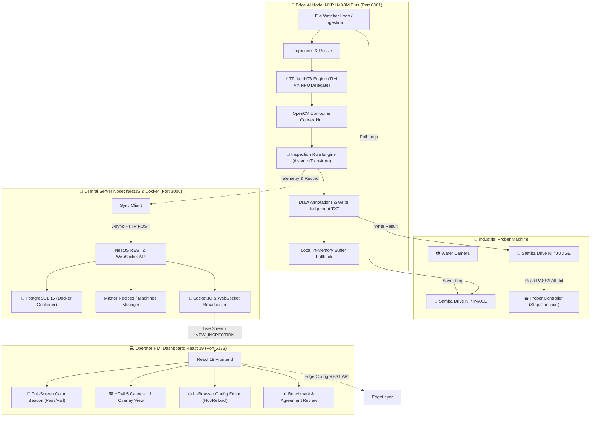

# 🔬 สรุปรายละเอียดเชิงลึก: ระบบตรวจจับและวิเคราะห์ตำหนิบนแผ่น Semiconductor Wafer ด้วย Edge AI
### (AI Wafer Inspection HMI Dashboard on NXP i.MX8M Plus & Central PC)

เอกสารฉบับนี้รวบรวมรายละเอียดทางเทคนิคทั้งหมดของโปรเจกต์อย่างละเอียด ทั้งวัตถุประสงค์, สถาปัตยกรรมระบบ (System Architecture), โมเดล Deep Learning, ตรรกะการตัดสินเชิงคณิตศาสตร์ (Inspection Rule Engine), การเชื่อมต่อเครื่องจักรโรงงาน (Prober Integration), โครงสร้างฐานข้อมูล, และแนวทางการนำไปเรียบเรียงเป็นรายงานวิชาการหรือรายงานสหกิจศึกษา/ฝึกงาน พร้อมทั้ง Master Prompt สำหรับสร้างรายงาน

---

## 📌 1. บทนำและวัตถุประสงค์ของโปรเจกต์ (Project Introduction & Problem Statement)

### 1.1 ที่มาและความสำคัญ (Background)
ในกระบวนการผลิตสารกึ่งตัวนำ (Semiconductor Manufacturing) ขั้นตอนการทดสอบเวเฟอร์ (Wafer Probe Testing / PMI - Post-Probe Metrology Inspection) เป็นขั้นตอนสำคัญในการทดสอบการทำงานของแต่ละ Die (ชิป) บนแผ่นเวเฟอร์ โดยเครื่องจักร Prober จะใช้หัวเข็ม (Probe Card) กดลงบนแผ่นสัมผัสโลหะ (Bond Pad / Pad) เพื่อส่งสัญญาณไฟฟ้าทดสอบ
* **ปัญหาเดิม (Traditional Problem):** 
  * การตรวจรอยกดเข็ม (Probe Mark) ต้องใช้พนักงาน Operator ส่องกล้องหรือดูหน้าจอ ทำให้เกิดความล้า (Eye Fatigue), ใช้เวลาตรวจนาน (Bottleneck), และมีโอกาสผิดพลาดจากมนุษย์ (Human Error / Subjective Bias)
  * ระบบตรวจจับแบบดั้งเดิมบางระบบส่งภาพไปประมวลผลบน Cloud หรือ Server ส่วนกลาง ทำให้เกิดปัญหาความหน่วงของเครือข่าย (Network Latency) และหากเครือข่ายขัดข้อง สายการผลิตต้องหยุดชะงัก (Downtime)

### 1.2 วัตถุประสงค์หลัก (Core Objectives)
1. **พัฒนา Edge AI Node ประสิทธิภาพสูง:** นำโมเดล Deep Learning (U-Net Semantic Segmentation) มารันบนบอร์ดประมวลผลริมขอบระดับอุตสาหกรรม **NXP i.MX8M Plus** เพื่ออนุมานผล (Inference) ในระดับ Real-time (< 20–50 ms)
2. **สร้าง Rule-Based Decision Engine:** คำนวณระยะห่างทางกายภาพระดับไมโครเมตร (Micrometer / Pixel), เปอร์เซ็นต์พื้นที่รอยกดเข็ม, และตรวจสอบความสมบูรณ์ของ Pad ตามเกณฑ์อุตสาหกรรม
3. **ผสานระบบอัตโนมัติกับเครื่องจักร (Prober Automation):** อ่านภาพถ่ายและเขียนไฟล์ตัดสินผล (Single Text Judgement File: PASS/FAIL) ผ่าน Samba/CIFS Network Share ของเครื่องจักร Prober โดยอัตโนมัติ
4. **ออกแบบระบบ 3-Tier Dual-Node ที่เสถียร:** แยกส่วนงานประมวลผลหน้างาน (Edge Node) ออกจากส่วนบันทึกข้อมูลส่วนกลาง (Central Server Node) และหน้าจอสั่งการ (HMI Web Dashboard) เพื่อให้ Edge ยังทำงานตรวจจับได้ต่อเนื่องแม้ Server ส่วนกลางจะปิดปรับปรุง
5. **ระบบวัดผลความแม่นยำและห้องแล็บ (Benchmark & Validation Engine):** ตรวจวัดและเปรียบเทียบผลระหว่าง AI และมนุษย์ คำนวณค่า Overkill (ทิ้งของดี), Underkill (หลุดของเสีย), และ Confusion Matrix

---

## 🏗️ 2. สถาปัตยกรรมระบบโดยรวม (3-Tier Dual-Node System Architecture)

ระบบถูกออกแบบเป็นสถาปัตยกรรมแบบ Decoupled 3-Tier ดังนี้:



---

## 💻 3. รายละเอียดเชิงลึกของแต่ละโมดูล (Component Deep-Dive)

### 3.1 Edge AI Node (`backend_imx8` - FastAPI / Python)
* **รันบน:** บอร์ด NXP i.MX8M Plus (Quad Cortex-A53 @ 1.8GHz พร้อม NPU 2.3 TOPS) หรือทดสอบบน PC ในโฟลเดอร์ Simulation
* **จุดรับภาพ (Ingestion & Watcher Pipeline):**
  * สแกนโฟลเดอร์ `lot.source.folder` (เช่น `N:\WP269\PMI\IMAGE`) ผ่าน CIFS Mount
  * ถอดรหัสชื่อไฟล์รูปภาพตามรูปแบบมาตรฐานอุตสาหกรรม:
    * `[0] ProcessTime`: วันที่และเวลาตรวจสอบ
    * `[1] WaferID / LotID`: รหัสแบทช์หรือแผ่นเวเฟอร์ (เช่น `WP269`)
    * `[2] Coordinate`: พิกัดพิกัด Die XY บนเวเฟอร์
    * `[3] Site`: หมายเลขหัววัด (Site ID เช่น S1, S2)
    * `[4] PadNo`: หมายเลข Pad (เช่น P1, P24)
    * `[5] Device`: ชนิดของชิปหรือแพ็กเกจ
  * ตรวจสอบสัญญาณสิ้นสุดแบทช์ผ่านไฟล์สกุล `.END.bmp` หรือตรวจจับผ่าน Idle Timeout
* **การสั่งการเครื่องจักร (Machine Handshake):**
  * เมื่อตรวจเสร็จแต่ละ Lot จะสร้างไฟล์ Judgement ในไดเรกทอรี `N:\WP269\PMI\JUDGE`
  * ชื่อไฟล์ตามฟอร์แมตเครื่อง Prober: `{RESULT}_{CODE}_{MACHINE}_{TIMESTAMP}.txt`
  * ตัวอย่าง: `PASS_0000_WP269_20261012153000.txt` หรือ `FAIL_0101_WP269_20261012153000.txt`
  * หากพบ Fail เครื่องจักรจะอ่านไฟล์แล้วหยุด (Stop Machine) เพื่อให้ช่างตรวจสอบทันที

### 3.2 โมเดล AI และการบีบอัด (Deep Learning Model & Edge Optimization)
* **สถาปัตยกรรมโครงข่ายประสาทเทียม:** U-Net Semantic Segmentation Architecture หรือ YOLOv8-Segmentation
* **การจำแนกคลาส (Classes):**
  * **Class 0 - Pad:** หน้าสัมผัสโลหะบนชิป
  * **Class 1 - Probemark:** รอยเข็มกดลงบนเนื้อโลหะ Pad
  * **Class 2 - Silicon Grain / Contamination:** เศษผงซิลิคอนหรือสิ่งเจือปนจากการกดเข็ม
* **การ Optimize สู่ฮาร์ดแวร์ NPU (Quantization):**
  * โมเดลตั้งต้นถูกเทรนด้วย PyTorch (`.pth`)
  * ผ่านกระบวนการ **Full Post-Training INT8 Quantization (PTQ)** โดยใช้ Calibration Dataset ภาพเวเฟอร์จริง
  * แปลงเป็น **TensorFlow Lite (`.tflite`)** เพื่อเรียกใช้งานผ่าน **NXP eIQ TIM-VX NPU Delegate (`libvx_delegate.so`)**
  * ลดขนาดโมเดลจาก ~120MB เหลือเพียง ~13–31MB และลดเวลาคำนวณจาก >300ms บน CPU เหลือเพียง **15–35 ms บน NPU**

### 3.3 Inspection Rule Engine (กฎการตัดสินเชิงคณิตศาสตร์)
กฎเกณฑ์ทั้งหมดถูกประมวลผลผ่าน OpenCV และ NumPy มี 7 กฎหลัก:

| ลำดับกฎ | ชื่อกฎ (Rule Name) | เกณฑ์มาตรฐาน (Threshold) | สมการ / วิธีการคำนวณทางคณิตศาสตร์ | ผลการตัดสิน |
|:---:|:---|:---:|:---|:---:|
| **1** | **Distance to Pad Edge** (ระยะรอยเข็มถึงขอบ Pad) | $\ge 8.0\ \mu\text{m}$ (หรือ 8 พิกเซล ที่ $160\times 160$) | ใช้ `cv2.distanceTransform` บน Pad Mask เพื่อวัดระยะจากจุดพิกเซลที่ใกล้ที่สุดของ Probemark ถึงเส้นขอบ Pad หากพิกเซลใดอยู่นอก Pad ระยะ = 0 | ถ้าระยะ $< 8.0\ \mu\text{m}$ $\rightarrow$ **FAIL** (รอยเข็มชิดหรือหลุดขอบ) |
| **2** | **Area Ratio Check** (สัดส่วนพื้นที่รอยเข็ม) | $\le 25.0\%$ | $\text{Ratio} = \frac{\sum \text{Area}(\text{Probemark Masks})}{\text{Area}(\text{Pad Mask})} \times 100\%$ | ถ้าสัดส่วน $> 25.0\%$ $\rightarrow$ **FAIL** (เข็มกดแรงเกินไปหรือเนื้อพัง) |
| **3** | **Missing Probemark** (ไม่พบรอยกดเข็ม) | Strict Mode (`fail`) | ตรวจพบคอนทัวร์ของ Pad แต่ $\text{Count}(\text{Probemark}) = 0$ | ตัดสินเป็น **FAIL** (เข็มลอย ไม่สัมผัสหน้าชิป) |
| **4** | **No Pad Detected** (ไม่พบคอนทัวร์ Pad) | Hard-coded Fail | $\text{Count}(\text{Pad}) = 0$ | ตัดสินเป็น **FAIL** (ภาพมืด เล็งภาพเพี้ยน หรือกล้องเสีย) |
| **5** | **Pre-processing ROI Filter** | 70% ตรงกลางภาพ | กรองขอบภาพด้านข้างและบนล่าง $V_{\text{ROI}} = 0.7$, $H_{\text{ROI}} = 0.7$ | ข้าม Pad ที่ถูกขอบภาพตัดครึ่งเพื่อไม่ให้ผลลวง |
| **6** | **Min Area Filter** (กรองสัญญาณรบกวน) | Pad: 300 px, Mark: 10 px, Grain: 5 px | ตรวจสอบพื้นที่คอนทัวร์ $\text{ContourArea} < \text{MinArea}$ | กำจัดจุดรบกวน (Noise Artifacts) ก่อนส่งเข้า Rule |
| **7** | **Grain Correction** | Visual Only | นำ Mask ของ Grain ที่แตะ Pad มารวม (Bitwise OR) แล้วทำ `ConvexHull` | กู้คืนรูปทรง Pad ที่เว้าแหว่งให้กลับมาสมบูรณ์ |

### 3.4 Central Server Node (`backend_pc` - NestJS / TypeScript)
* **บทบาท:** เซิร์ฟเวอร์ประสานงานส่วนกลางระดับโรงงาน (Industrial Gateway)
* **ฐานข้อมูล (Database):**
  * **PostgreSQL 15** รันผ่าน Docker เก็บประวัติการตรวจ (Wafer ID, Lot, Pass/Fail, Confidence, Image URL, Inference Time, Rule Time)
  * **Fallback Mechanism:** มีระบบ In-memory Array สำรอง หากฐานข้อมูลหลักออฟไลน์ เซิร์ฟเวอร์ยังคงตอบสนองต่อหน้างานได้ทันที
* **การส่งข้อมูลแบบ Real-time:**
  * ใช้ **Socket.IO** และ **Native WebSocket Server (`/ws/hardware`)** กระจายอีเวนต์ `NEW_INSPECTION` และสถานะฮาร์ดแวร์ (CPU, RAM, Temp) สู่หน้าจอ HMI ภายในเวลา < 5 ms
* **Config & Model Synchronizer:**
  * ทำหน้าที่เป็น Single Source of Truth สำหรับไฟล์สูตรการผลิต (Recipes) และไฟล์คอนฟิกเครื่องจักร (Machines) สามารถกดกระจาย (Sync) จากเซิร์ฟเวอร์กลางลงไปยัง Edge Node หลายๆ ตัวได้

### 3.5 HMI Web Dashboard (`frontend` - React 19 + Vite)
* **ออกแบบเฉพาะสำหรับ Industrial Touchscreen:**
  * **Full-Screen Visual Beacon:** หน้าจอเปลี่ยนสีพื้นหลังสว่างวาบทั้งผืน (เขียว = PASS, แดง = FAIL) ให้ Operator ในคลีนรูมสังเกตเห็นได้จากระยะไกล 5–10 เมตร
  * **HTML5 Canvas 1:1 Frame-Perfect Overlay:** วาดภาพเวเฟอร์ความละเอียดสูง พร้อมตีกรอบ Polygon และ Bounding Box ซ้อนทับอย่างแม่นยำ รองรับการ Zoom & Pan แบบสัมผัส
  * **In-Browser Config Editor Modal:** มี Code Editor ในตัวสำหรับแก้ไขไฟล์ Recipe JSON ตรวจสอบความถูกต้อง (JSON Linting), ฟอร์แมต JSON, และบันทึกแบบ **Hot-Reload** ให้ Edge Node อัปเดตพารามิเตอร์ทันทีโดยไม่ต้อง Restart Service
  * **Benchmark & Agreement Review Modal:** หน้าต่างตรวจสอบความแม่นยำแบบ Blind Test ระหว่างผลตรวจ AI และการตัดสินของช่างเทคนิค พร้อมออกรายงานสถิติ

---

## 📊 4. ระบบวัดคุณภาพระดับห้องปฏิบัติการ (Benchmark & Quality KPIs)

เพื่อรองรับการตรวจสอบมาตรฐานคุณภาพสารกึ่งตัวนำ ระบบได้บรรจุสูตรคำนวณ KPI ทางวิศวกรรมการผลิต (Manufacturing KPIs) ไว้ในระบบ Benchmark ดังนี้:

$$\text{Agreement Rate} = \frac{\text{True Defect (TP)} + \text{True Good (TN)}}{\text{Total Reviewed}} \times 100\%$$

$$\text{Overkill Rate (Type I Error / False Positive)} = \frac{\text{AI FAIL, Human PASS (FP)}}{\text{Total Reviewed}} \times 100\%$$
*(Overkill คือชิ้นงานดีแต่ AI ตัดสินว่าเสีย ส่งผลต่อ Yield Loss)*

$$\text{Underkill Rate (Type II Error / False Negative)} = \frac{\text{AI PASS, Human FAIL (FN)}}{\text{Total Reviewed}} \times 100\%$$
*(Underkill คือชิ้นงานเสียแต่ AI ปล่อยให้ผ่าน ส่งผลร้ายแรงที่สุดในวงการเซมิคอนดักเตอร์เพราะของเสียจะหลุดไปหาลูกค้า)*

$$\text{AI Yield} = \frac{\text{AI PASS Count}}{\text{Total Tested}} \times 100\% \quad \text{vs} \quad \text{True Yield} = \frac{\text{Human PASS Count}}{\text{Total Reviewed}} \times 100\%$$

---

## 🗄️ 5. โครงสร้างฐานข้อมูล (Database Schema Reference)

### ตารางหลัก: `inspections` (PostgreSQL / TypeORM)
```sql
CREATE TABLE inspections (
    id SERIAL PRIMARY KEY,
    wafer_id VARCHAR(255) NOT NULL,
    timestamp VARCHAR(255) NOT NULL,
    decision VARCHAR(50) DEFAULT 'PASS',
    "padsTotal" INTEGER DEFAULT 1,
    "padsDetected" INTEGER DEFAULT 1,
    "probeMarks" INTEGER DEFAULT 0,
    grains INTEGER DEFAULT 0,
    confidence REAL DEFAULT 95.0,
    "inferenceTime" REAL DEFAULT 0.0,
    "ruleTime" REAL DEFAULT 0.0,
    "machineAction" VARCHAR(100) DEFAULT 'CONTINUE PROCESS',
    reason VARCHAR(255) DEFAULT '-',
    "imageUrl" TEXT,
    "createdAt" TIMESTAMP DEFAULT CURRENT_TIMESTAMP
);
```

### ตารางทดสอบโมเดล: `benchmark_results`
```sql
CREATE TABLE benchmark_results (
    id SERIAL PRIMARY KEY,
    session_id VARCHAR(100) NOT NULL,
    image_name VARCHAR(255) NOT NULL,
    image_url TEXT,
    annotated_image_url TEXT,
    raw_image_url TEXT,
    ai_decision VARCHAR(50),
    ai_confidence REAL,
    ai_reason TEXT,
    inference_time_ms REAL,
    rule_time_ms REAL,
    min_edge_distance_um REAL,
    mark_area_ratio_pct REAL,
    pads_count INT,
    marks_count INT,
    grains_count INT,
    human_decision VARCHAR(50) DEFAULT 'UNREVIEWED',
    human_reviewer VARCHAR(100) DEFAULT '-',
    reviewed_at VARCHAR(100) DEFAULT '-',
    notes TEXT
);
```

---

## 📑 6. โครงร่างรายงานทางวิชาการ / รายงานสหกิจศึกษา (Report Structure Blueprint)

หากต้องการนำเนื้อหาไปจัดเรียงเป็นรายงานโปรเจกต์ 5 บท สามารถใช้โครงสร้างนี้ได้ทันที:

### บทที่ 1: บทนำ (Introduction)
* 1.1 ความเป็นมาและความสำคัญของปัญหา (การผลิตแผ่นเวเฟอร์และการตรวจรอย Probe Mark)
* 1.2 วัตถุประสงค์ของโครงการ
* 1.3 ขอบเขตของโครงการ (ใช้บอร์ด NXP i.MX8M Plus, โมเดล U-Net TFLite INT8, ระบบ HMI React 19)
* 1.4 ประโยชน์ที่คาดว่าจะได้รับ (ลดเวลาการตรวจสอบ, ป้องกันของเสียหลุด, ทำงานแบบ Real-time หน้างาน)

### บทที่ 2: ทฤษฎีและงานวิจัยที่เกี่ยวข้อง (Literature Review & Technologies)
* 2.1 กระบวนการทดสอบทางไฟฟ้าของเวเฟอร์ (Wafer Probing & Probe Mark Inspection)
* 2.2 สถาปัตยกรรม Edge Computing และบอร์ดประมวลผล NXP i.MX8M Plus (NPU Architecture)
* 2.3 ทฤษฎีการแบ่งส่วนภาพด้วยโครงข่ายประสาทเทียมแบบคอนโวลูชัน (U-Net Semantic Segmentation)
* 2.4 การบีบอัดโมเดลเพื่อฮาร์ดแวร์เฉพาะทาง (Post-Training Quantization: INT8)
* 2.5 การประมวลผลภาพดิจิทัลและเรขาคณิต (OpenCV Distance Transform & Convex Hull)
* 2.6 สถาปัตยกรรมเว็บแอปพลิเคชันและการสื่อสารแบบสองทาง (NestJS, React 19, WebSockets)

### บทที่ 3: การออกแบบและพัฒนาระบบ (System Design & Implementation)
* 3.1 สถาปัตยกรรมระบบภาพรวม (Dual-Node 3-Tier Architecture)
* 3.2 การพัฒนาส่วนประมวลผล AI บนขอบ (Edge AI Pipeline & TFLite TIM-VX Runner)
* 3.3 การพัฒนาระบบกฎเกณฑ์การตัดสิน (Rule-Based Engine: Distance, Area Ratio, Missing Mark)
* 3.4 การเชื่อมต่อเครื่องจักร Prober (CIFS Ingestion, Judgement Text Generation)
* 3.5 การพัฒนา Central Server & Database (NestJS, PostgreSQL, TypeORM, Fallback)
* 3.6 การพัฒนาหน้าจอผู้ใช้งานระดับอุตสาหกรรม (HMI Dashboard, Beacon, In-browser Config Editor)

### บทที่ 4: ผลการทดสอบและการวิเคราะห์ผล (Experimental Results & Analysis)
* 4.1 ประสิทธิภาพความเร็วในการอนุมานผล (Inference Latency บน CPU vs NPU)
* 4.2 ความแม่นยำในการตรวจจับและตัดสินผล (Accuracy, Agreement Rate, Overkill, Underkill)
* 4.3 การทดสอบจำลองการทำงานร่วมกับเครื่องจักร (Simulation & Machine Interlocking Test)
* 4.4 การทดสอบความเสถียรของระบบเครือข่ายและการรับส่งข้อมูล Real-time

### บทที่ 5: สรุปผลและข้อเสนอแนะ (Conclusion & Future Work)
* 5.1 สรุปผลการดำเนินงาน
* 5.2 ปัญหาและอุปสรรคที่พบระหว่างการพัฒนา
* 5.3 แนวทางการพัฒนาต่อยอดในอนาคต (Multi-Machine 1-to-N Clustering, Auto-retraining Pipeline)

---

## 🤖 7. แม่แบบพร้อมพ์สำหรับนำไปสร้างรายงาน (Master Prompt for Report Writing)

สามารถคัดลอกข้อความด้านล่างนี้ไปสั่ง AI เพื่อให้เขียนเนื้อหารายงานอย่างละเอียดทีละบทได้:

```text
คุณคือผู้เชี่ยวชาญด้านวิศวกรรมคอมพิวเตอร์และระบบอัตโนมัติในโรงงานเซมิคอนดักเตอร์ (Industrial Edge AI & Computer Vision Expert)
ช่วยเขียนเนื้อหารายงานวิชาการ/รายงานสหกิจศึกษาอย่างละเอียดและเป็นทางการ ในหัวข้อ:
"ระบบตรวจจับและวิเคราะห์ตำหนิบนแผ่น Semiconductor Wafer ด้วย Edge AI (AI Wafer Inspection HMI Dashboard)"

ข้อมูลอ้างอิงของโปรเจกต์:
1. ฮาร์ดแวร์ประมวลผล: NXP i.MX8M Plus (Quad Cortex-A53 + NPU 2.3 TOPS สถาปัตยกรรม VeriSilicon TIM-VX)
2. สถาปัตยกรรมระบบ: 3-Tier Dual-Node ประกอบด้วย
   - Edge Node: FastAPI (Python) รัน TFLite INT8 Quantized U-Net Model + OpenCV Rule Engine
   - Central Server Node: NestJS (TypeScript) + PostgreSQL 15 + WebSocket Gateway
   - HMI Dashboard: React 19 + HTML5 Canvas + Full-Screen Color Beacon
3. กระบวนการตรวจสอบ:
   - ตรวจจับ 3 คลาส: Pad (หน้าสัมผัส), Probemark (รอยเข็ม), Grain (สิ่งเจือปน)
   - กฎการตัดสิน: Distance Check (>= 8.0 um ด้วย cv2.distanceTransform), Area Ratio (<= 25%), Missing Mark Detection
   - Handshake กับเครื่อง Prober ผ่าน Samba Share N: และ M: โดยเขียนไฟล์ PASS/FAIL txt ให้เครื่องจักร
4. ระบบประเมินผล: คำนวณ Agreement Rate, Overkill Rate (FP), Underkill Rate (FN), Yield

กรุณาเขียนเนื้อหาของ [ระบุบทที่ต้องการ เช่น บทที่ 1, บทที่ 2 หรือ บทที่ 3] โดยใช้ภาษาทางวิชาการที่กระชับ สมบูรณ์ มีการอธิบายสมการและสถาปัตยกรรมอย่างเป็นลำดับขั้นตอน
```
